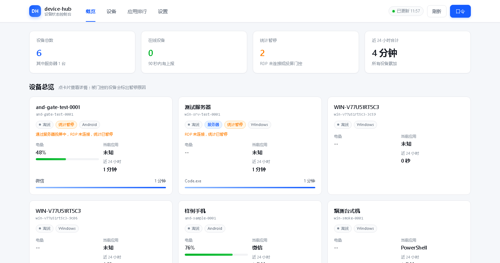
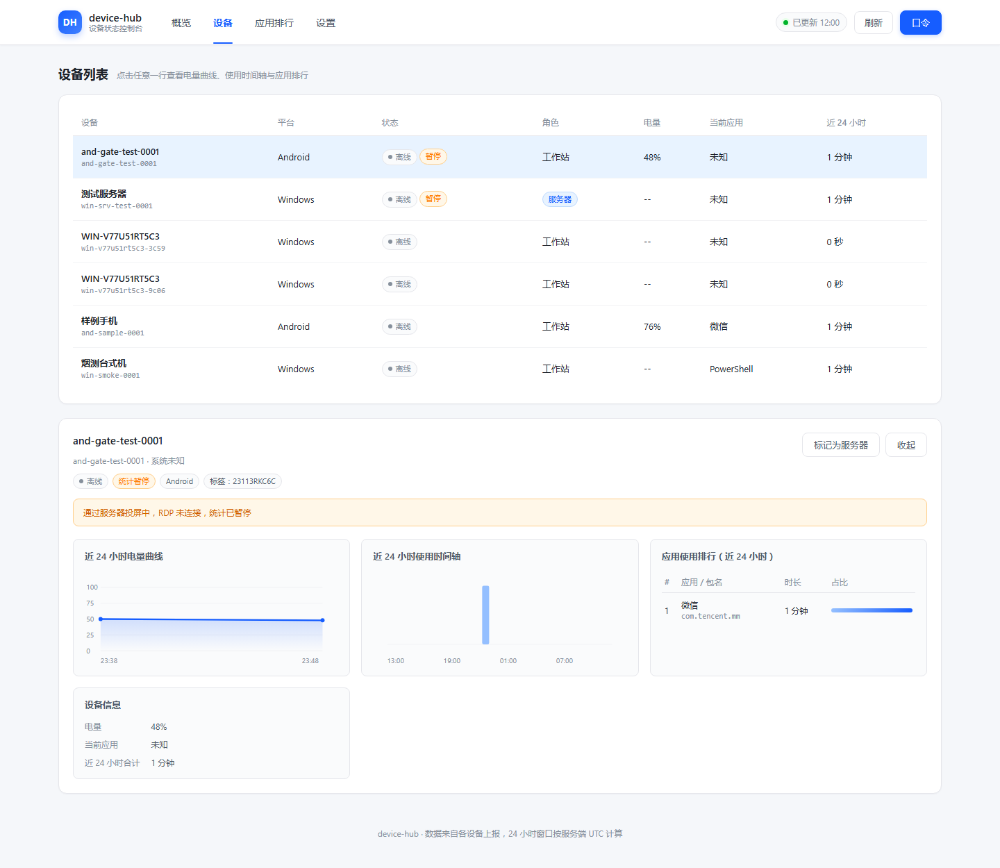
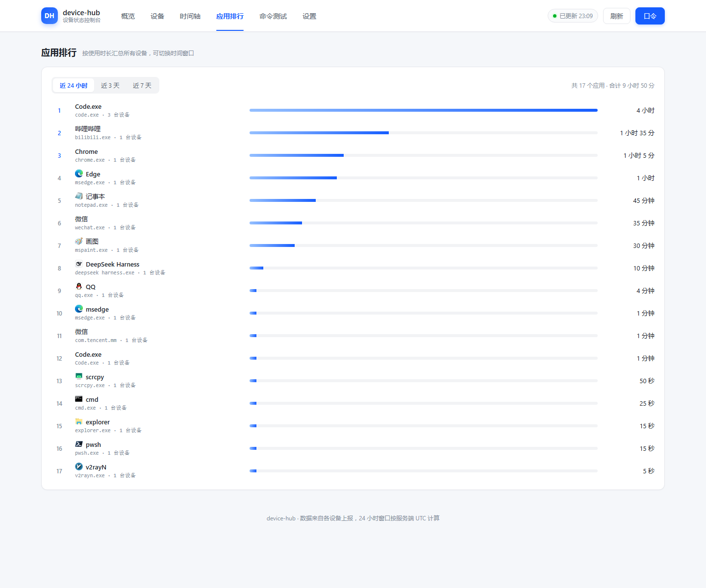
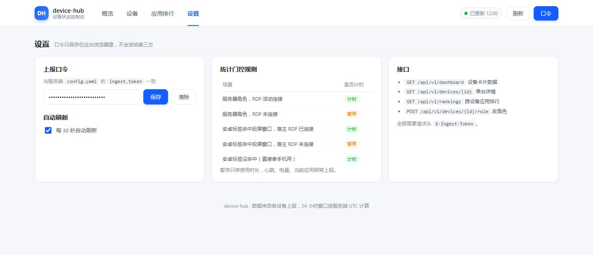
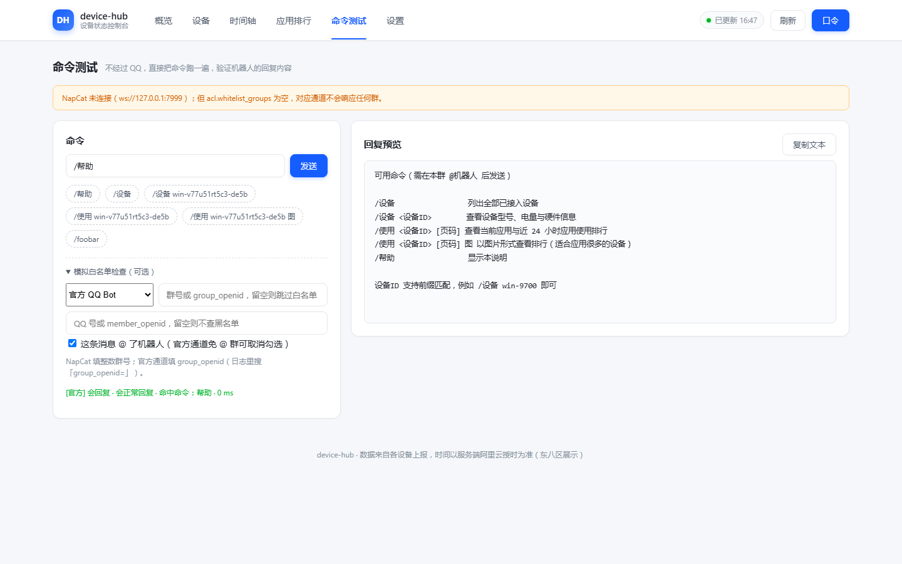
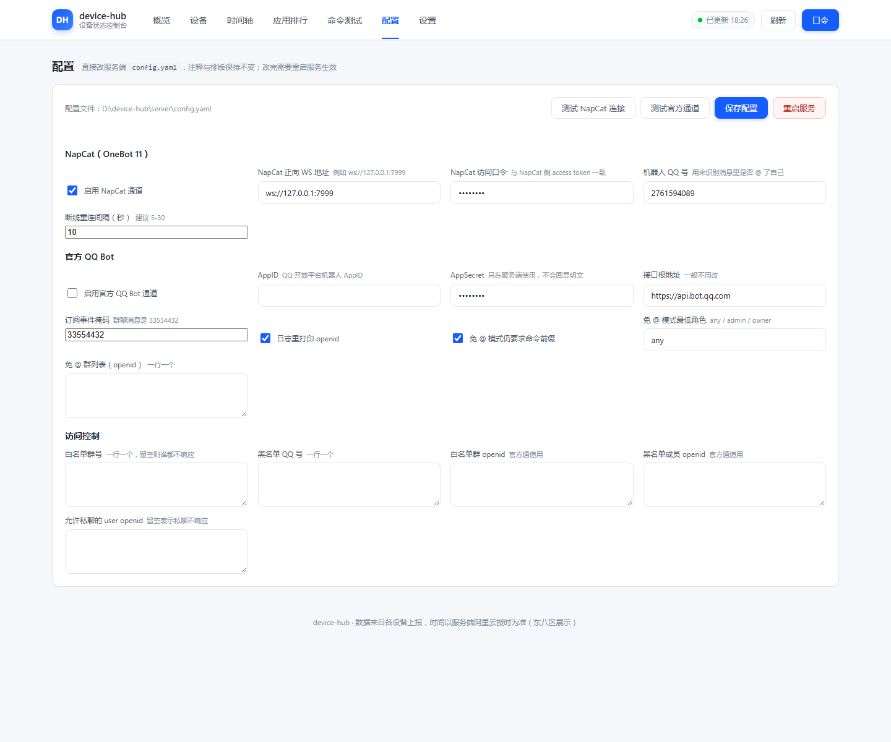

# 部署与联调手册

本文按"从零到群里能收到回复"的顺序写，每一步都给出可验证的检查方法。

## 0. 组件清单

| 组件 | 位置 | 说明 |
| --- | --- | --- |
| 服务端 | `D:\device-hub\server` | FastAPI + SQLite + 机器人 |
| Windows 采集端 | `D:\device-hub\client-windows` | Python，采集硬件与前台应用 |
| Android 采集端 | `D:\device-hub\client-android` | Kotlin，见 `android.md` |
| QQ 通道 | `C:\NapCat.Shell.Windows.Node\napcat` | NapCat，OneBot 11 |
| 官方 QQ 通道（可选） | `q.qq.com` 开放平台 | 官方 QQ Bot，无需 NapCat，见 `qqbot.md` |

## 1. 准备服务端配置

仓库里只放 `server/config.example.yaml`，真实配置不进版本库（里面有 AppSecret 和上报口令）。
先复制一份再改：

```powershell
cd D:\device-hub\server
Copy-Item config.example.yaml config.yaml
```

`server/config.yaml` 必须改的只有三处：

```yaml
ingest:
  # 换成随机长串，客户端要用同一个值
  token: "改成你自己的随机串"
acl:
  # 填上允许使用的群号，留空则任何群都不响应
  whitelist_groups: [123456789]
napcat:
  # 与 NapCat 里 DeviceHub 服务端的 token 保持一致，自己生成一个随机串填进去
  token: "改成你自己的 NapCat token"
```

> `acl.whitelist_groups` 为空时机器人不会响应任何群，这是刻意的安全默认值。
> 官方 QQ Bot 通道用的是另一套命名空间，白名单填在 `acl.whitelist_group_openids` 里。

## 2. 启动服务端

```powershell
cd D:\device-hub\server
python -m venv .venv
.\.venv\Scripts\Activate.ps1
pip install -r requirements.txt -i https://mirrors.aliyun.com/pypi/simple/
python -m app.main
```

验证：

```powershell
# 应返回 ok 与版本号
curl http://127.0.0.1:8080/healthz
```

## 3. 让 NapCat 打开 7999 端口

项目已在 `onebot11_<你的机器人QQ>.json` 里新增了一个名为 `DeviceHub` 的正向 WebSocket 服务端：

| 字段 | 值 |
| --- | --- |
| host | `127.0.0.1` |
| port | `7999` |
| token | 与 `napcat.token` 填同一个随机串 |
| messagePostFormat | `array` |

**该改动需要重启 NapCat 才会生效**，重启会短暂断开 MaiBot 与 Stapxs QQ Lite 两条现有连接。步骤：

1. 关闭 NapCat 与 QQ（托盘退出，或结束 `NapCatWinBootMain.exe` 与所有 `QQ.exe`）。
2. 运行 `C:\NapCat.Shell.Windows.Node\napcat\launcher.bat`。
3. 确认端口已监听：

```powershell
Get-NetTCPConnection -State Listen -LocalPort 7999
```

改动前的配置备份在 `onebot11_<你的机器人QQ>.json.bak-<时间戳>`，需要回滚时直接覆盖回去。

## 4. 启动 Windows 采集端

首次运行会自动生成 `config.json`（含设备 ID 与口令，已在 `.gitignore` 里忽略）。

```powershell
cd D:\device-hub\client-windows
python -m venv .venv
.\.venv\Scripts\Activate.ps1
pip install -r requirements.txt -i https://mirrors.aliyun.com/pypi/simple/

# 先干跑一次，确认字段正确（不会真的发送）
python -m agent --dry-run --server http://192.168.2.245:8080 --token 你的token

# 常驻运行
python -m agent --server http://192.168.2.245:8080 --token 你的token
```

打包成 exe：`.\build.ps1`，产物在 `dist\device-hub-agent.exe`（约 12MB，单文件）。
打包成 exe：`.\build.ps1`，产物在 `dist\device-hub-agent.exe`（约 12MB，单文件）。

exe 是**窗口化**打包（`--noconsole`），双击运行不会弹黑窗口：

| 启动方式 | 行为 | 日志 |
| --- | --- | --- |
| `device-hub-agent.exe` | 静默常驻，无窗口 | `agent.log`（exe 同目录） |
| `device-hub-agent.exe --debug` | 弹一个标题为「device-hub 采集端日志」的控制台窗口，日志实时滚 | 控制台 + `agent.log` |
| `device-hub-agent.exe --once --debug` | 只上报一次，窗口显示完即退出，适合排错 | 控制台 + `agent.log` |

`--debug` 除了开窗口，还把日志级别降到 DEBUG，HTTP 细节也会打出来。
配置写错时窗口化 exe 会弹一个系统提示框（而不是静默退出），提示内容同时写进 `agent.log`。

> exe 的配置文件 `config.json` 会生成在 **exe 同目录**（`dist\config.json`），
> 不是源码目录；拷贝 exe 到别的机器时把 `config.json` 一起带上即可。
> 待上报的使用时长缓存在同目录的 `usage-state.json`，上报成功会自动删除。

> 采集端必须跑在**交互式桌面会话**里（任务计划程序选"只在用户登录时运行"）。
> 如果锁屏、远程桌面断开、或用 nssm 装成服务，`GetForegroundWindow()` 会返回 0，
> 当前应用会显示"未知"，但硬件信息、电量与上报本身仍然正常。

## 5. 群里验证

在白名单群里 @机器人 后发送：

```
/happy帮助
/设备
/使用 <设备ID>
/使用 <设备ID> 1 图
```

不想开 QQ 时，可以在服务端目录直接用调试工具看渲染结果：

```powershell
cd D:\device-hub\server
.\.venv\Scripts\python.exe -m scripts.demo_bot "/设备"
.\.venv\Scripts\python.exe -m scripts.demo_bot "/happy设备"
```

## 5.1 官方 QQ Bot 通道（可选，与 NapCat 并存）

官方通道不依赖 NapCat，也不受 QQ 客户端版本影响，代价是要在开放平台注册机器人、
并且群标识换成不透明的 `group_openid`。完整协议细节见 [qqbot.md](qqbot.md)，这里只给最短路径：

1. 在 `q.qq.com` 创建机器人，记下 `AppID` 与 `AppSecret`。
2. 在开放平台把机器人拉进目标群（沙箱环境同样操作）。
3. 打开配置并重启服务端：

```yaml
qqbot:
  enabled: true
  app_id: "你的 AppID"
  app_secret: "你的 AppSecret"
  log_openids: true
acl:
  # 官方通道用 openid，不是整数群号，别和 whitelist_groups 混填
  whitelist_group_openids: []
```

4. 群里 @机器人 发一句 `/happy帮助`，然后在服务端日志里找这一行，把 openid 抄进白名单：

```
QQ Bot 事件：group_openid=XXXX member_openid=YYYY role=member
```

5. 把 `group_openid` 填进 `acl.whitelist_group_openids` 后重启，再发一次就应有回复。

> 群消息默认必须 @ 机器人才响应。想让某个群免 @（直接发 `/happy设备`），把它的
> `group_openid` 加进 `qqbot.free_command_group_openids`；免 @ 时仍要求 `/` 前缀，
> 还可以用 `qqbot.free_command_min_role` 限制成仅管理员/群主。

验证：

```powershell
# 逐通道状态，connected=true 表示官方通道已连上
curl -H "X-Ingest-Token: 你的token" http://127.0.0.1:8080/api/v1/bot/status
```

```powershell
# 不经过 QQ 直接测官方通道的准入判断（openid 白名单不填时会返回 group_not_whitelisted）
$body = '{"text":"/happy帮助","channel":"qqbot","group_id":"你的group_openid","mention":true}'
Invoke-RestMethod -Method Post -Uri http://127.0.0.1:8080/api/v1/bot/command `
  -Headers @{ "X-Ingest-Token" = "你的token" } -ContentType "application/json" -Body $body
```

## 6. 开机自启（可选）

服务端与采集端都可以用任务计划程序启动，触发器选"登录时"，操作为：

```powershell
# 服务端
D:\device-hub\server\.venv\Scripts\python.exe -m app.main
# 采集端（工作目录设为 client-windows）
D:\device-hub\client-windows\.venv\Scripts\python.exe -m agent
```

## 7. 故障排查

| 现象 | 可能原因 | 处理 |
| --- | --- | --- |
| 客户端返回 401 | 两边 token 不一致 | 比对 `config.yaml` 与客户端 `config.json` |
| 客户端返回 422 | 字段缺失或时间没带时区 | 看响应里的 `detail`，字段名会写清楚 |
| 客户端返回 413 | 请求体超过 256KB | 调大 `ingest.max_payload_bytes` 或减少应用条数 |
| 群里 @机器人 没反应 | 群号不在白名单 / 没 @ / 机器人没连上 | 看服务端日志 `已连接 NapCat`，核对 `whitelist_groups` |
| 日志报 401 连接 NapCat 失败 | `napcat.token` 与 NapCat 配置不一致 | 改 `config.yaml` 或 NapCat 侧 token |
| 发图失败 | NapCat 图片上传受限或 base64 过大 | 先用文本命令，或缩小 `render.page_size` |
| `/happy设备` 里设备显示离线 | 客户端 90 秒没上报 | 检查采集端进程与网络 |
| 官方通道日志报 `token 调用失败` | `app_id` / `app_secret` 不对，或该 IP 未在开放平台加白 | 核对凭据；企业主体需要在平台配置 IP 白名单 |
| 官方通道连上但群里没反应 | `acl.whitelist_group_openids` 为空或不匹配 | 看日志里的 `group_openid=`，逐字比对（openid 区分大小写） |
| 官方通道报 `err_code 40054xxx` | 主动消息配额用尽或被去重 | 命令走被动回复（带 `msg_id`），配额按群每分钟 20 条、每天 1000 条算 |
| 当前应用一直显示"未知" | 采集端不在交互式桌面会话里（锁屏、远程桌面断开、被注册成服务） | 用"登录时启动"的普通进程运行；锁屏期间本来就没有前台窗口 |

## 8. 安全提醒

- 上报走明文 HTTP，仅适合内网或 Tailscale；对公网暴露请加反向代理与 HTTPS。
- 当前没有"设备归属 QQ"的绑定，白名单群内任何人都能查询所有设备的状态。
- 数据库默认保留明细 7 天、聚合 30 天，可在 `retention` 里调整。

## 9. 服务器角色、RDP 门控与看板

### 9.1 为什么需要门控

那台主机白天当远程工作站用、晚上挂着投屏手机。如果照常统计，
"人不在也没关 RDP"的时间会被算成使用时长，数据就假了。所以：

- 标记为**服务器**的设备，只在 RDP 处于**活动连接**（WTSActive）时统计使用时长；
- 通过 scrcpy 投屏的安卓设备，跟随**宿主服务器**的 RDP 状态——人在用服务器才说明人在用那台手机；
- 如果 scrcpy 根本没连（手机上直接玩），服务端**不会丢包**，照常统计。

### 9.2 配置写法

`server/config.yaml`：

```yaml
roles:
  # 强制指定为服务器的设备 ID，优先级高于客户端自己声明的 role
  servers: ["win-srv-1a2b"]
  # 强制指定为工作站的设备 ID，常用于纠正客户端误标
  workstations: []
gating:
  # 关掉就退回"所有设备都统计"的旧行为
  enabled: true
  # rdp_connected 多久没更新就算过期（秒），默认 180
  rdp_stale_seconds: 180
  # 远程桌面目标校验：前台是 mstsc 且目标是自己人时，改由那台设备计时
  rdp_require_known_client: true
  # 手动放行的目标地址或机器名，按自己人处理（frp / tailscale 地址可以写这里）
  rdp_allowed_clients: []
```

> 陌生客户端 RDP 连进服务器**不会**暂停统计，那台服务器照常计时；反过来，本机前台是
> 远程桌面客户端时，只有「连过去的目标是受监控设备」才暂停，认不出来的目标（例如
> frp / tailscale 中转地址）会照常记为 `mstsc.exe` 的使用时长喵。

也可以用 Web 看板点按钮改角色，改完立即生效（写进数据库 `devices.role`）。

### 9.3 客户端侧

Windows 采集端 `config.json`：

```json
{
  "role": "server",
  "tag": "客厅主机",
  "mirror_process_names": ["scrcpy.exe"]
}
```

- `role`：`workstation`（默认）或 `server`。服务器角色会自动检测 RDP 与 scrcpy 窗口。
- `mirror_process_names`：投屏工具进程名，默认 `scrcpy.exe`；用 QtScrcpy 就改成它的进程名。
- `tag`：服务器自身标签，一般不用填；安卓端的标签用于和 scrcpy 窗口标题匹配。

Android 端在界面上填「设备标签」，默认用手机型号（scrcpy 窗口标题通常就是型号）。

### 9.4 看板

浏览器打开 `http://192.168.2.245:8080/`，白色主题，最上面是功能栏：

| 标签 | 内容 |
| --- | --- |
| 概览 | 设备总数 / 在线 / 统计暂停 / 近 24 小时合计四个指标 + 设备卡片，卡片上直接写暂停原因 |
| 设备 | 设备表格（状态、角色、电量、当前应用、时长），点任意一行展开详情：电量曲线、小时级使用时间轴、应用排行（带包名）、硬件信息、角色切换按钮 |
| 应用排行 | 跨设备汇总的应用使用排行，可切近 24 小时 / 近 3 天 / 近 7 天 |
| 命令测试 | 不经过 QQ，直接把 `/happy帮助`、`/happy干了什么`、`/happy在干嘛` 等命令跑一遍，看机器人会回什么 |
| 设置 | 口令保存与清除、自动刷新开关、门控规则速查、接口列表 |

- 右上角「口令」按钮填 `ingest.token`，口令只存在浏览器 localStorage，不进 URL；
- 页面每 30 秒自动刷新（可在设置里关掉），无任何外部 CDN 依赖，断网内网也能用；
- 地址栏带 hash 路由，刷新后停在原来的标签页和设备上。









### 9.4.1 时间口径（客户端 / 服务端 / 看板一致）

时间只有一个来源：**服务端向阿里云 NTP 对齐后的时钟**。

- 服务端启动时对齐一次 `ntp.aliyun.com`（失败依次换 `ntp1`–`ntp4`，再失败退到阿里云官网的 HTTP `Date` 头），之后默认每 30 分钟重新对齐；
- 上报落库的时间戳（心跳、电量、使用时长、窗口快照）一律用服务端收到上报的时刻，**客户端把自己的系统时间写成 2035 年也不会影响统计**；客户端自报的 `reported_at` 只用于去重与排查时钟偏差；
- 看板不读浏览器时钟：页面加载与每次刷新都会请求 `GET /api/v1/time` 拿到 `server_now`，之后的「现在」线、日期、「已更新」时间都按这个偏移算；
- 时间轴的日期分桶与刻度也按服务端下发的 `tz_offset_minutes` 换算，把电脑时区改成 UTC+0 或 UTC-5，看到的仍然是同一份东八区数据。

配置（`server/config.yaml`）：

```yaml
clock:
  enabled: true
  servers: []          # 留空用内置的 ntp.aliyun.com ~ ntp4.aliyun.com
  sync_interval_seconds: 1800
  timeout_seconds: 2.0
```

想确认当前授时状态：`GET /api/v1/time` 会返回 `source`（例如 `ntp:ntp.aliyun.com`）、`offset_seconds`（本机快慢多少秒）与 `synced`。

### 9.5 时间轴（按天看 0-24 点）

顶部功能栏进「时间轴」，可以选设备、选日期（前一天 / 后一天 / 今天）：

- 最上面一条是当天 0-24 点的总览色块，每个应用一种颜色；**空档**画成 45° 灰色斜纹，**离线**直接留空（没有心跳就什么都不画）；
- 下面每个应用一条泳道，右侧是该应用当天累计时长；
- 悬停任意色块能看到起止时间与时长；
- 右上角汇总当天总计、空档、离线与段数；
- 「现在」竖线按真实时间平滑右移，顶部小标签显示到秒；
- 鼠标在时间轴上悬停（总览条或任一应用泳道都行）时，虚线指针会标出那一刻，浮层显示「时刻 · 应用 · 那一刻的窗口标题」（同一应用换了标题只在这里体现，不会拆出多条泳道）；
- 那一刻**没有使用记录**时，浮层会直接说明原因：`空档（在线但无使用记录）` 或 `离线（无心跳）`，所以看到斜纹不等于有使用记录。
- 色块宽度等于真实时长，只保留 1 像素的视觉下限；窗口窄或倍率小时，间隔不到 1 像素的相邻同应用片段会自动合并成一块（悬停提示会写「N 段合计 X 秒」），放大后立刻恢复成独立色块，所以精度要求高时不会出现长度失真。

两种「没在计时」的状态是分开的，别混着看：

| 状态 | 判定 | 说明 |
| --- | --- | --- |
| 空档 | 有心跳，但这一分钟没有任何使用记录 | 人在挂机，或者统计被门控暂停（投屏、RDP 等） |
| 离线 | 连续 `heartbeat_timeout_seconds`（默认 60 秒）没有心跳 | 采集端没启动、被关掉，或者机器关机 |

注意空档不等于「上报里 `afk` 为真」。手机亮着屏（`afk=false`）但因为被门控暂停计时时，同样没有使用记录，那也是空档——只要设备还在线，这一分钟没画出色块就一定画成斜纹，时间轴上不允许出现无使用记录的白缝。

心跳来自每次上报（默认 60 秒一次），服务端按分钟还原状态，所以离线区间精确到分钟。历史心跳只保留 `retention.detail_days` 天（默认 7 天），更早的日期不画状态区间，免得编造「离线 24 小时」。

缩放与平移：

- 滚轮向上放大、向下缩小，也可以点右上角的「缩小 / 放大 / 复位」；
- 缩放范围 1×–8640×，锚点跟着鼠标走，放大时鼠标下的时刻不会跑；
- 刻度分度值随倍数自动变细：1× 是 3 小时，放大到 240× 是 1 分钟，最大 8640× 是 1 秒，标签也自动带上秒；
- 放大后按住左键左右拖动就能平移，泳道左侧的应用名会吸在左边不跟着跑。

选「全部设备」或设备组时按**组**判断，不是按单台：

- 组里只要有一台设备有心跳，这一分钟就不算离线；
- 组里在线的设备**全都** AFK，这一分钟才算空档；
- 只要有一台设备在正常用，就既不算离线也不算空档。

统计口径对齐 patina / ActivityWatch：**Windows 采集端空闲超过 `afk_threshold_seconds`（默认 60 秒）就停止计时**，挂机时间不计入使用时长，在时间轴上表现为空档。0.4.0 起两端都会把「停表时刻 / 恢复时刻 / 最后一秒的计时时刻」随上报送上来：空档两端精确到秒、短空档（一分钟里被覆盖 30 秒以上）也会画出斜纹、色块按真实计时时刻落位；抓不到前台窗口时会退一步用 Z 序最上面的可见窗口，不再整段记成空白。上报失败只会让这一批数据延后：客户端把待上报记录还回累加器并落盘（`usage-state.json`），下一次上报一起补发，进程重启后照样补。上报频率用 `report_interval_seconds`（10–60 秒，默认 60）或启动参数 `--report-interval` 调整；上限 60 秒与服务端 60 秒心跳超时对齐，窗口快照另有 30 秒节流，短间隔上报不会放大桌面扫描开销。

要改阈值就在 `client-windows/config.json` 里加：

```json
{ "afk_threshold_seconds": 60 }
```

除了空闲，还有两条口径补充：

- **锁屏立刻算 AFK**（`WTSQuerySessionInformation(WTSSessionInfoEx)` 读会话标志）：锁屏时人肯定不在用，
  不用等满 60 秒，也避免「锁屏但鼠标在动」被算成在用；
- **空档边界精确到秒**：采集端随上报带上 `afk_since` / `active_since`（停表 / 恢复的时刻），
  服务端把斜纹边界挪到这两个时刻，色块与斜纹之间不再留空白。老客户端不带这两个字段时按整分钟算。

截图见 `docs/dashboard-timeline.png`。

#### 9.6 统计口径（五个场景）

实际判定顺序，从客户端到服务端：

| # | 场景 | 结果 |
| --- | --- | --- |
| 1 | 电脑 RDP 连上服务器，人不动 | 服务器键鼠空闲 60 秒 → `afk`，服务器与投屏中的手机都不计时 |
| 2 | 服务器连了 scrcpy 但窗口在后台 | 服务器计时，手机暂停（`mirror_background`） |
| 2 | 服务器前台是 scrcpy | 手机计时，服务器暂停（`mirror_foreground`） |
| 2 | 服务器 RDP 断开，scrcpy 窗口还在前台 | 服务器与手机都不计时，手机原因是 `mirror_rdp_disconnected`（断线后那张画面是残留的，没法操作） |
| 3 | 电脑前台是远程桌面客户端（mstsc / msrdc） | 本机不计时（人在操作远端机器） |
| 4 | Windows 端键鼠空闲 > 60 秒 | 停止采集使用时长，有输入后立刻恢复；进入 AFK 的那一批照样带着刚才的秒数（服务端不会丢） |
| 4 | Windows 端锁屏 | 立刻停止计时（不等 60 秒），解锁后立刻恢复 |
| 4 | 前台窗口抓不到（UAC / 切桌面 / 窗口重建） | 沿用上一个应用，最多 2 分钟；期间人在动就继续计时 |
| 5 | 活跃时 | 每 5 秒采样，按设定间隔上报（10–60 秒，默认 60），满足「至少每分钟一次」；AFK 状态一变立刻补一次 |

暂停只停「使用时长」，心跳、电量、当前应用、窗口列表照常上报，所以设备在线状态与电量曲线不受影响。看板设备详情里会直接写出暂停原因，设置页有完整规则表。

#### 9.5.3 窗口列表与存储清理

Windows 采集端每次上报会带上当前所有已打开的窗口（应用名、exe 名、窗口标题、是否最小化、是否前台），设备详情页右侧直接能看到：

- 前台窗口排最前并标「前台」，最小化的标「最小化」；
- 单次最多 80 个窗口，系统壳层窗口（`Program Manager` 等）自动跳过；
- 安卓端没有这个概念，显示「没有窗口数据」。

窗口历史默认**不自动删除**。设置页有一块「存储占用」：显示库文件、WAL、各表行数和时间范围，下面填「保留最近 N 天」点「清理更早的数据」即可，清理后会 `VACUUM` 让文件真的变小。截图见 `docs/dashboard-storage.png`、`docs/dashboard-windows.png`。

#### 9.5.2 应用图标

采集端会顺手把应用图标传给服务端，每个应用只传一次：

- Windows 端按三种方式依次尝试抠 32×32 图标，自己编码 PNG，**不依赖 Pillow**：
  1. `ExtractIconExW`（最常见，能抠出 exe 里第 0 个图标）；
  2. `PrivateExtractIconsW`（按目标尺寸抠，多尺寸图标里挑最合适的）；
  3. `SHGetFileInfoW`（走外壳图标，兜住前两种抠不出的应用）；
- 每次上报除了前台应用，还会给**窗口列表里所有应用**补图标（每轮最多 12 个），所以常驻后台的 QQ、v2rayN 这类也会有图；
- 抠出来的图至少要 5% 不透明像素才算成功，避免把空白图传上去；服务端也会拒收小于 8×8 的占位图；
- 安卓端用 `PackageManager.getApplicationIcon` 转 48×48 PNG，包名记在本地偏好里避免重传；
- 服务端存进 `app_icons` 表，看板的时间轴泳道、应用排行与窗口列表都会显示图标，没有图标的应用退回色块；
- 图标键由「应用名 + 小写包名」算 sha1，服务端启动时会把历史行按新规则重算一遍，升级后不会出现「有图但显示不出来」。

图标只是锦上添花：抠不到、传失败都只记 debug 日志，绝不影响使用时长上报。

#### 9.5.1 设备组（人）

点时间轴工具栏的「编辑设备组」：

- 一个组就是一个人，组内可以放多台设备；
- 芯片上的数字是优先级，`↑` `↓` 调顺序，`×` 移出组；
- 下拉里选「添加设备…」把设备加进来，「删除组」整组删掉，「新增设备组」加一个空组；
- 点「保存」写进服务端 `data/people.json`，换浏览器/换电脑都还在。

时间轴的设备下拉会多出「设备组」分组，选中即按该组设备合并成一条时间轴；组内顺序就是优先级，时间真的重叠时靠前的设备保留完整时长，靠后的被裁掉重叠部分。截图见 `docs/dashboard-people.png`。

### 9.6 验证门控是否生效

```powershell
# 上报响应里 stats_paused=true 且 usage_rows_written=0，说明被门控
curl -X POST http://127.0.0.1:8080/api/v1/report `
  -H "X-Ingest-Token: <token>" -H "Content-Type: application/json" `
  -d '{"device_id":"win-srv-1a2b","platform":"windows","reported_at":"2026-10-29T17:40:00+08:00","role":"server","rdp_connected":false,"usage_delta":[{"app":"Code.exe","seconds":60}]}'
```

群里 `/happy设备` 会显示「统计：RDP 未连接，统计暂停」。

### 9.7 命令测试（QQ 掉线时也能验）

QQ 账号异常下线、NapCat 没启动、或者只是想确认排版时，用看板的「命令测试」页：

1. 顶部功能栏点「命令测试」；
2. 输入框里写命令，例如 `/happy设备`、`/看看happy 全部 排行榜`，点「发送」（不用写斜杠也行）；
3. 右边直接显示机器人会发到群里的文本；图片命令会把 PNG 渲染出来；
4. 状态行会写「会回复 / 不会回复 · 原因 · 命中命令 · 耗时」；
5. 展开「模拟白名单检查」填上群号和 QQ 号，就能看到真实环境里这条消息会不会被 ACL 拦掉。

对应接口是 `POST /api/v1/bot/command`，请求体 `{"text": "/设备", "group_id": 可选, "user_id": 可选}`，
字段说明见 [上报协议](protocol.md)。它只读数据库、不发任何 QQ 消息。



### 9.8 在看板上改配置、测连接、重启服务

不想每次都去服务器上改 `config.yaml`、再手动重启时，用看板的「配置」页：

1. 顶部功能栏点「配置」，页面会列出 NapCat / 官方 QQ Bot / 访问控制三组可改项；
2. 改完点「保存配置」——服务端只重写被改动的那几行，**注释和排版都保留**，
   写盘前会先跑一遍完整校验，校验不过直接报错、原文件不动；
3. **保存即生效，不用重启**：服务端写完盘就重新加载配置并换掉内存里的那份，
   机器人相关项（`napcat` / `qqbot` / `acl`）有变化时会自动断开旧连接、按新配置重连；
   只有 `server.port` / `server.db_path` 这种绑在进程上的项才需要重启（设置页也改不了它们）；
4. 密钥（NapCat token、AppSecret）只显示 `********`，不动它就不会被覆盖；
5. 「测试 NapCat 连接」「测试官方通道」会用**磁盘上的最新配置**真连一次：
   NapCat 走 `get_login_info`（口令错会明确提示），官方通道走换票 + 取网关；
6. 万一确实需要重启（例如换了端口），点「重启服务」，页面会等到 `/healthz` 回来再自动刷新。
   重启是起一个分离进程重新拉起 `python -m app.main`，日志继续追加到 `server/data/server.log`。



对应的三个接口是 `GET|PATCH /api/v1/settings`、`POST /api/v1/bot/test`、`POST /api/v1/server/restart`，
字段与取值规则见 [上报协议](protocol.md)。

喵~注意：

- 重启只会重读配置，**不会**丢数据；但如果新配置本身写错（例如把 `server.port` 改成了被占用的端口），
  服务会起不来，这时到服务器上看 `server/data/server.log` 手动改回即可。
- 看板里改不了 `ingest.token`，避免改完之后所有客户端和当前浏览器一起失联；要换口令请直接改配置文件。
- 热更新只在服务端进程内换配置对象，**已经在跑的上报请求**用的是取到那一刻的配置，不影响后续请求。
